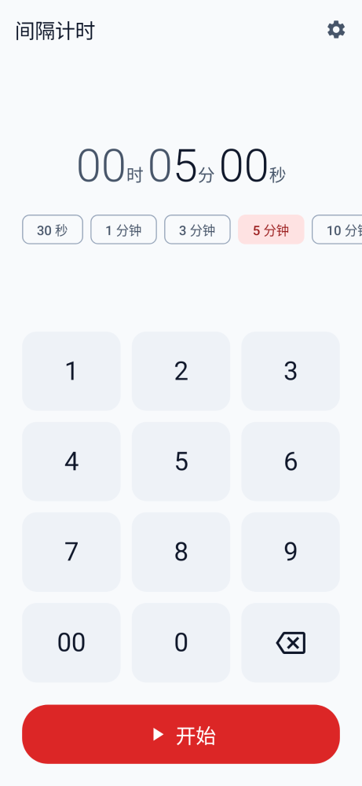
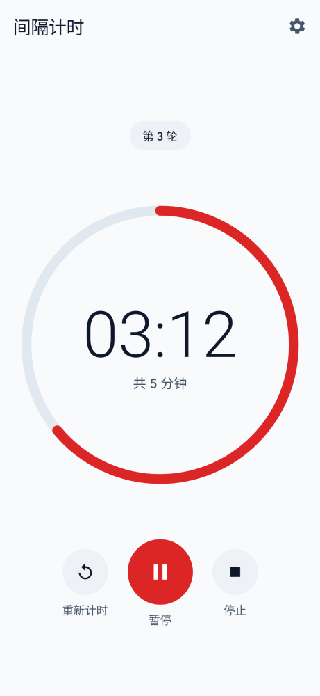
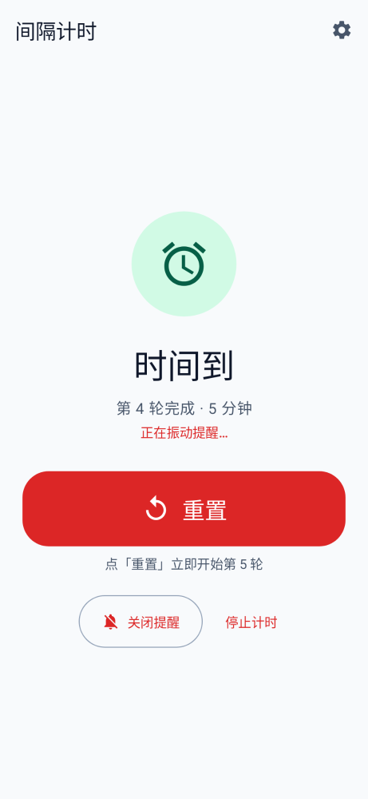
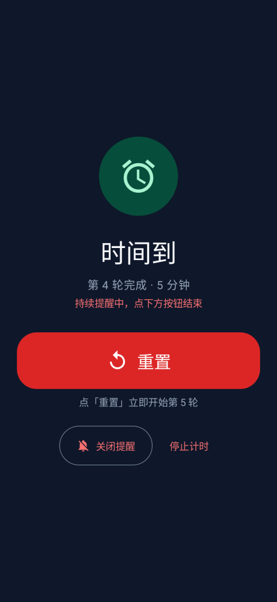
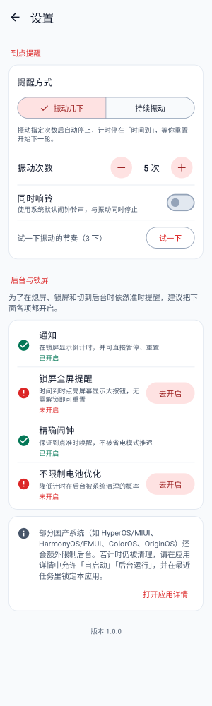

# 间隔计时（Interval Timer）

一个专注于“重复倒计时”的 Android 应用：设定时长 → 开始 → 时间到振动提醒 → 一键重置立即开始下一轮。即使熄屏、锁屏或切到后台也能准时提醒，**锁屏状态下无需解锁即可重置**。

| 设定 | 计时中 | 时间到 | 锁屏提醒（深色） | 设置 |
|---|---|---|---|---|
|  |  |  |  |  |

> 截图由 Paparazzi 截图测试在 JVM 上渲染生成（`app/src/test/snapshots/images/`）。

## 功能

- **设定时长**：数字键盘（时/分/秒，从右往左填）+ 快捷预设（30 秒 ~ 25 分钟），默认填入上次的时长。
- **倒计时**：大号等宽数字 + 环形进度；支持暂停/继续、本轮重新计时、停止；显示当前轮次。
- **时间到提醒（可配置）**：
  - 振动几下（1–30 下，默认 5 下）后自动停止；或
  - 持续振动，直到手动重置/关闭提醒/停止；
  - 可选同时播放系统闹钟铃声。
- **重置即下一轮**：时间到后点“重置”，用相同时长立即开始下一轮。
- **后台驻留**：前台服务 + `AlarmManager.setAlarmClock` 精确唤醒 + 状态持久化，进程被杀也能恢复。
- **锁屏操作**：锁屏通知上直接点“重置 / 关闭提醒 / 停止”；时间到时点亮屏幕，在锁屏之上显示大号“重置”按钮。
- **权限体检**：设置页实时显示通知、锁屏全屏提醒、精确闹钟、电池优化豁免的状态，一键跳转系统设置。
- 浅色/深色主题跟随系统；支持大字体、横屏、读屏。

完整说明与限制见 [docs/FEATURES.md](docs/FEATURES.md)，设计规范见 [docs/DESIGN.md](docs/DESIGN.md)。

## 首次使用建议

1. 第一次点“开始”时允许**通知**权限（锁屏显示和操作都依赖它）。
2. 打开 **设置 → 后台与锁屏**，把显示“未开启”的项逐个点“去开启”：
   - 锁屏全屏提醒（Android 14+）
   - 不限制电池优化
3. 使用国产 ROM（HyperOS/MIUI、HarmonyOS/EMUI、ColorOS、OriginOS 等）时，还需在应用详情里允许“自启动 / 后台运行”，并在最近任务中锁定本应用。

## 构建

环境要求：

| 组件 | 版本 |
|---|---|
| JDK | 17 |
| Android SDK | Platform 35、Build-Tools 35.0.0 |
| Gradle | 8.11.1（使用自带 wrapper） |
| AGP / Kotlin | 8.7.3 / 2.0.21 |

在项目根目录创建 `local.properties`（已被 `.gitignore` 忽略）：

```properties
sdk.dir=/path/to/Android/sdk
```

常用命令：

```bash
./gradlew assembleDebug            # 调试包：app/build/outputs/apk/debug/app-debug.apk
./gradlew testDebugUnitTest        # 单元测试 + 截图渲染
./gradlew verifyPaparazziDebug     # 截图对比（UI 改动后需 recordPaparazziDebug 更新基准图）
./gradlew lintDebug                # Android Lint
./gradlew assembleRelease          # 发布包（未签名，需自行配置签名）
```

安装到手机：

```bash
adb install -r app/build/outputs/apk/debug/app-debug.apk
```

需要代理时，可通过 `-Dhttps.proxyHost=… -Dhttps.proxyPort=…`（以及 `proxyUser`/`proxyPassword`）传给 `./gradlew`，不要把凭据写进仓库。

## 系统要求与权限

- Android 8.0（API 26）及以上，目标 Android 15（API 35）。
- 权限用途：

| 权限 | 用途 |
|---|---|
| `POST_NOTIFICATIONS` | 显示倒计时通知与锁屏操作按钮 |
| `FOREGROUND_SERVICE` / `FOREGROUND_SERVICE_SPECIAL_USE` | 会话期间保持后台运行 |
| `USE_EXACT_ALARM` / `SCHEDULE_EXACT_ALARM`（≤ API 32） | 到点精确唤醒 |
| `USE_FULL_SCREEN_INTENT` | 时间到时在锁屏上显示提醒页 |
| `VIBRATE` / `WAKE_LOCK` | 振动提醒，并在提醒期间保持 CPU 唤醒 |
| `REQUEST_IGNORE_BATTERY_OPTIMIZATIONS` | 引导用户把应用加入电池优化白名单 |

## 项目结构

```
app/src/main/java/app/intervaltimer/
├── IntervalTimerApp.kt        # Application + 手写依赖容器
├── timer/                     # 状态机、控制器、持久化、闹钟调度、时长输入
├── service/                   # 前台服务、通知、振动/铃声
├── receiver/                  # 闹钟回调、通知按钮
├── settings/                  # 提醒设置
├── system/                    # 权限/系统设置状态检查
└── ui/                        # Compose 界面（计时、设置、锁屏提醒、主题）
docs/
├── FEATURES.md                # 功能文档
└── DESIGN.md                  # 设计系统
AGENTS.md                      # 给 AI 编码代理的开发约定
```

## 文档

- [docs/FEATURES.md](docs/FEATURES.md)：已实现的功能、工作方式、已知限制
- [docs/DESIGN.md](docs/DESIGN.md)：配色、字体、间距、动效、无障碍规范
- [AGENTS.md](AGENTS.md)：架构、约定、命令与文档维护规则
